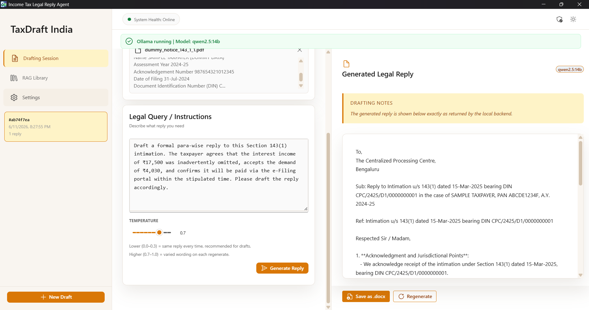
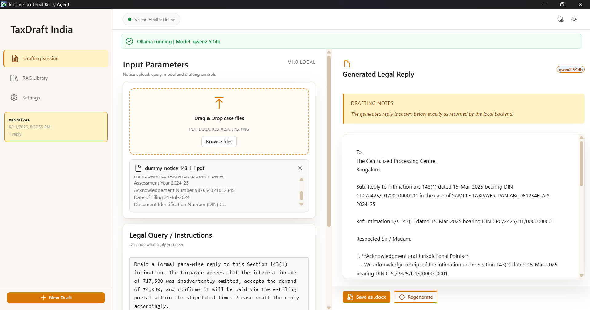

# TaxDraft India — Income Tax Legal Reply Agent

<!-- Badges -->


> A fully local Windows desktop application for Indian income tax
> professionals to draft formal replies to ITD notices using
> local LLMs, RAG, and automatic legal document sync.

---

## Features

- **Fully local** — no data leaves your machine, no cloud API
- **LLM-powered replies** — qwen2.5:14b for standard notices,
  deepseek-r1:14b auto-selected for complex cases (reassessment,
  search & seizure, penalty, transfer pricing, DTAA, etc.)
- **RAG pipeline** — IT Act 2025, IT Act 1961, Finance Acts,
  IT Rules 1962 and CBDT circulars auto-indexed via Indian Kanoon
- **Auto-sync** — scheduled daily sync (default noon, configurable
  via cron expression) fetches the latest legal updates
- **Multi-file, multi-format input** — drop a notice plus computation
  sheets and supporting docs in one go (PDF, DOCX, XLS, XLSX, JPG, PNG)
- **Excel-aware** — extracts text from computation sheets,
  Form 26AS, AIS/TIS, and TDS reconciliations (.xls + .xlsx)
- **Save as .docx** — formal letter output in Times New Roman
- **System tray** — minimises to tray and keeps the scheduler alive
- **Security hardened** — path traversal, XXE, prompt injection,
  RAG poisoning protections

---

## Tech Stack

| Layer | Technology |
|---|---|
| Frontend | Electron 37 + React 19 + TypeScript + Vite 7 + Fluent UI v9 |
| Backend | Python 3.11 + FastAPI + Uvicorn |
| LLM | Ollama (qwen2.5:14b primary, deepseek-r1:14b auto-fallback) |
| RAG | ChromaDB + sentence-transformers (all-MiniLM-L6-v2) |
| Legal Data | Indian Kanoon API |
| OCR | Tesseract |
| Packaging | PyInstaller + electron-builder + NSIS |

---

## Prerequisites

### Build machine (developer)
- Windows 10/11 x64
- Python 3.11+ in PATH
- Node.js 20+ in PATH (24.x tested)
- Tesseract OCR from UB Mannheim at the default install path
- Internet connection

### Deploy machine (end user)
- Windows 10/11 x64
- 32 GB RAM recommended (16 GB minimum — replies will be slow)
- A GPU is **not** required. The 14B models run if **either**
  **10 GB+ free VRAM** (NVIDIA, RTX 3060 12 GB or better) **or**
  **20 GB+ free system RAM** is available — 32 GB and no GPU is a
  supported configuration and runs on CPU. Below both thresholds the
  app still works but routes every notice to `qwen2.5:14b` and logs a
  warning. See [Model Selection](#model-selection).
- Internet for first-time model download (~18 GB) and the daily
  Indian Kanoon sync

---

## Building from Source

```bash
# Clone the repository
git clone https://github.com/PratikKothari34/Indian_Income_Tax_Legal_Replying_Agent.git
cd Indian_Income_Tax_Legal_Replying_Agent

# Run build script (as Administrator)
.\build.bat
```

Output: `dist\ITaxReplyAgent-Setup.exe`

---

## Installation (Deploy Machine)

1. Add Windows Defender exclusion for the installer
2. Right-click installer → Properties → Unblock → OK
3. Run `ITaxReplyAgent-Setup.exe` as Administrator
4. Fill config page:
   - Ollama host/port (defaults fine)
   - Indian Kanoon API token (free at
     [api.indiankanoon.org](https://api.indiankanoon.org))
5. Wait for model downloads (~18GB, needs internet)
6. First launch downloads embedding model (~90MB)
7. After that — **fully offline**

---

## Indian Kanoon API Token

Required for automatic legal document sync.

1. Sign up at [api.indiankanoon.org](https://api.indiankanoon.org)
2. Request **non-commercial** use verification
3. Use description: "Local income tax reply tool for CA firm,
   no data redistribution, internal use only"
4. Enter token during install or via Settings panel

Non-commercial accounts get free ₹10,000/month credits.
At ₹0.20/document this covers ~50,000 document fetches/month.

---

## Usage

1. Launch app (or find in system tray)
2. Drop one or more case files (notice, computation, 26AS, etc.) — PDF, DOCX, XLS, XLSX, JPG, or PNG
3. Type query: "Draft a formal para-wise reply to this notice"
4. Click **Generate Reply**
5. Review the generated reply
6. Click **Save as .docx** when satisfied

### Temperature

The Temperature slider controls how varied the LLM's wording is on each
generation. Range is 0.0–1.0; the app defaults to 0.2, matching the
backend default. Low values favour citation accuracy over phrasing
variety, which is what legal drafting needs. Your last-used value is
remembered per machine.

- **0.0–0.3** — deterministic and conservative. The same notice produces
  near-identical replies on repeated generations. Recommended when
  citation accuracy and consistent tone matter most (most legal drafting).
- **0.4–0.6** — balanced. Slight variation in phrasing while still
  staying close to the model's most-likely wording.
- **0.7–1.0** — more varied. Useful when regenerating to explore an
  alternative draft, but raises the risk of looser citation discipline.

### Model Selection

Model selection is automatic — no manual choice is needed. Two inputs
decide it: notice complexity, and the hardware available at that moment.

| Notice | Hardware above threshold | Model tried first |
|---|---|---|
| Complex (reassessment, search & seizure, penalty, transfer pricing, s.263, DTAA, or text over 3,000 characters) | yes | `deepseek-r1:14b` |
| Standard | yes | `qwen2.5:14b` |
| Either | no | `qwen2.5:14b` (logged as a warning) |

If the first model cannot serve the request, the other one is tried —
so both remain reachable in every case.

**Hardware threshold.** The machine qualifies if **either** condition
holds:

- 10 GB or more *free* VRAM on an NVIDIA GPU, **or**
- 20 GB or more free system RAM.

Either alone is enough — a 32 GB machine with no NVIDIA GPU qualifies on
the RAM path and runs on CPU. Note the GPU check reads *free* VRAM, not
total, so a 12 GB card already loaded by another process can fall below
the line and quietly route a complex notice to `qwen2.5:14b`. The chosen
model is recorded in the reply metadata and the backend log.

### Supported Notice Types
- Section 143(1) — Intimation
- Section 143(2) — Scrutiny
- Section 148/148A — Reassessment
- Section 263 — Revision
- Section 271 — Penalty
- Search and seizure notices
- TDS/TCS discrepancy notices
- DTAA and transfer pricing matters

---

## Screenshots

**Drafting session — case file upload and legal query**



**Generated reply view**



---

## RAG Library

The app automatically syncs legal documents daily at noon:
- IT Act 2025 (section-wise)
- IT Act 1961 (key sections)
- Finance Acts
- IT Rules 1962
- CBDT circulars/notifications (auto-fetched via Indian Kanoon)

Documents are fetched automatically daily at noon via the
Indian Kanoon API. No manual steps required after initial setup.

---

## Development Setup

```bash
# Backend
cd backend
python -m venv .venv
.venv\Scripts\activate
pip install -r requirements.txt
python main.py

# Frontend (new terminal)
cd frontend
npm install
.\start.bat
```

**Backend port.** `python main.py` binds 127.0.0.1 and tries
`8000 → 8001 → 8002 → 8003`, taking the first free port, then writes the
bound port to `port.txt` (next to the backend in dev; under
`%LOCALAPPDATA%\ITaxReplyAgent` when installed). The Electron frontend
reads that file, so `port.txt` — not `8000` — is the source of truth
when the frontend cannot reach the backend. Check it first.

Running `uvicorn main:app --host 127.0.0.1 --port 8000` directly also
works, but pins the port and skips the `port.txt` write, so the frontend
will not discover a non-default port.

---

## Project Structure

```
├── backend/
│   ├── main.py              # FastAPI entry point
│   ├── routes/              # API endpoints
│   ├── services/            # Business logic
│   │   ├── ollama_client.py # LLM with auto model selection
│   │   ├── rag_scraper.py   # Indian Kanoon API scraper
│   │   ├── rag_embedder.py  # ChromaDB + embeddings
│   │   └── parser.py        # PDF/DOCX/Excel/Image parsing
│   └── requirements.txt
├── frontend/
│   ├── electron/            # Electron main + preload
│   ├── src/                 # React components
│   └── package.json
├── installer/
│   └── installer.nsh        # NSIS installer script
├── backend.spec             # PyInstaller spec
├── build.bat                # Build script
└── README.md
```

---

## Security

This application has undergone a red-team security audit:
- Path traversal protection on file uploads
- XXE guard on DOCX/XLSX parsing
- Prompt injection and RAG poisoning defenses
- IPC channel validation
- Session ID injection prevention
- Magic-byte file type verification
- Token masking in logs and API responses
- Localhost CSRF / DNS-rebinding guard — mutating API requests from a
  browser origin require a per-install auth token (`auth_token.txt`,
  attached automatically by the Electron shell), and the Host header
  is pinned to 127.0.0.1/localhost

See git history for detailed security commit notes.

---

## Contributing

Contributions welcome. Please:
1. Fork the repository
2. Create a feature branch
3. Make your changes
4. Submit a pull request

For major changes, open an issue first.

---

## License

This project is licensed under the GNU General Public License v3.0.
See [LICENSE](LICENSE) for details.

---

## Author

**Pratik V Kothari**
- GitHub: [@PratikKothari34](https://github.com/PratikKothari34)

---

## Acknowledgements

- [Ollama](https://ollama.com) — local LLM runtime
- [Indian Kanoon](https://indiankanoon.org) — legal database API
- [ChromaDB](https://trychroma.com) — vector database
- [sentence-transformers](https://sbert.net) — embedding models
- [FastAPI](https://fastapi.tiangolo.com) — backend framework
- [Electron](https://electronjs.org) — desktop framework
- [Fluent UI React](https://react.fluentui.dev) — UI component library
